<div align="center">

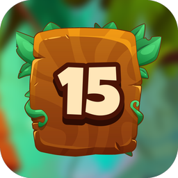

# Puzzle 15 — Jungle

**The classic sliding 15-puzzle, reborn in a hand-drawn jungle.**
Three board sizes, stars for fewer moves, and a world leaderboard.

[](https://github.com/AdilxanKenesov/Puzzle15_Game/actions/workflows/ci.yml)


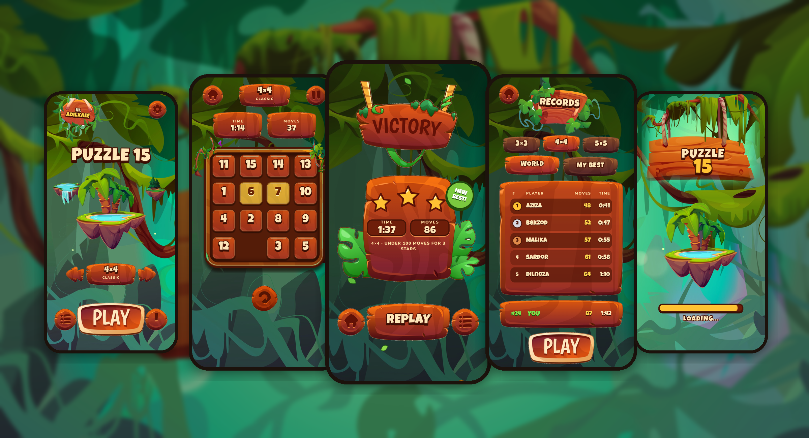

</div>

## Table of contents

- [Features](#features)
- [Screenshots](#screenshots)
- [Tech stack](#tech-stack)
- [Architecture](#architecture)
- [Project structure](#project-structure)
- [Getting started](#getting-started)
- [Firebase setup](#firebase-setup)
- [Testing and quality](#testing-and-quality)
- [CI/CD](#cicd)
- [Privacy](#privacy)
- [Credits and license](#credits-and-license)

## Features

- **Three board sizes.** 3×3 (easy), 4×4 (classic) and 5×5 (hard). Every shuffle is checked to be solvable, using inversion parity and the blank's row.
- **Stars and records.** Up to three stars for finishing near par. Each game is stored locally, and you get best moves, best time, games played, average moves and total stars per size.
- **World leaderboard.** The top 50 per board size, your exact rank, and "better than X% of players". It is built on Cloud Firestore with count aggregations.
- **Sign in your way.** Use Google through Credential Manager or play as a guest (anonymous Firebase account). A guest can later link Google and keep the same account and records.
- **Never lose a game.** An unfinished board is saved after every move and reopens paused, for each board size.
- **Feels like a game.**
  - Wooden tiles that spring into place, swinging signs, falling leaves and fireflies.
  - Music, sound effects and haptics, each switchable in Settings.
  - Music pauses when the app goes to the background.
- **Account control.** Sign out or delete the account in-app. Deletion removes the Firebase user and all cloud data, then resets the phone.
- **Release-ready.** R8-optimized builds, upload-key signing, and an adaptive icon with a themed (monochrome) layer.

## Screenshots

<table>
  <tr>
    <td align="center">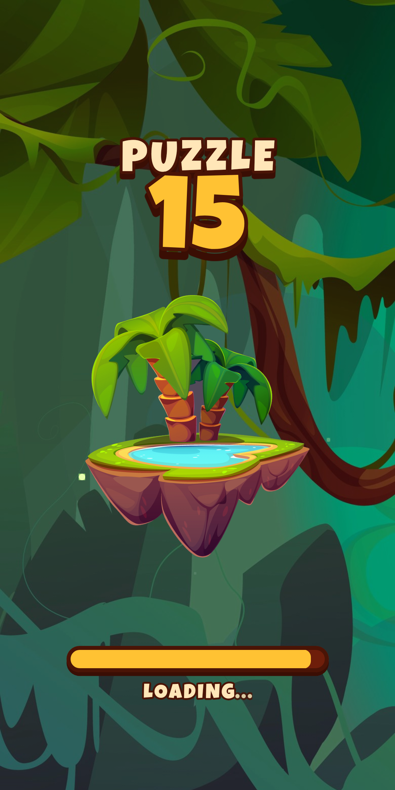<br/><sub>Splash</sub></td>
    <td align="center">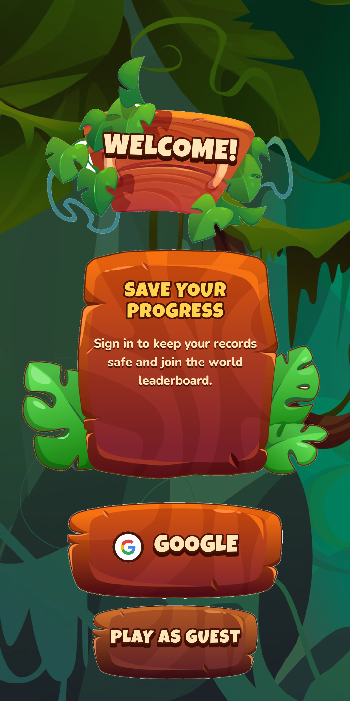<br/><sub>Sign in</sub></td>
    <td align="center">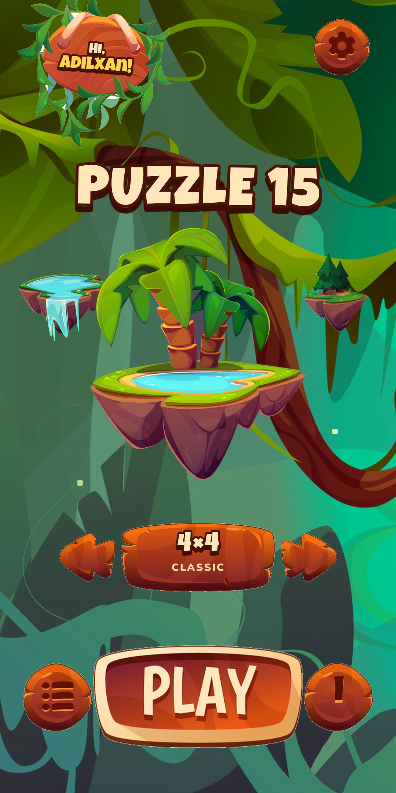<br/><sub>Main</sub></td>
    <td align="center">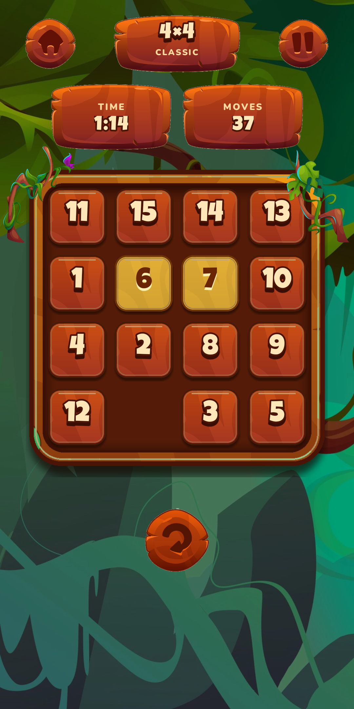<br/><sub>Game</sub></td>
  </tr>
  <tr>
    <td align="center">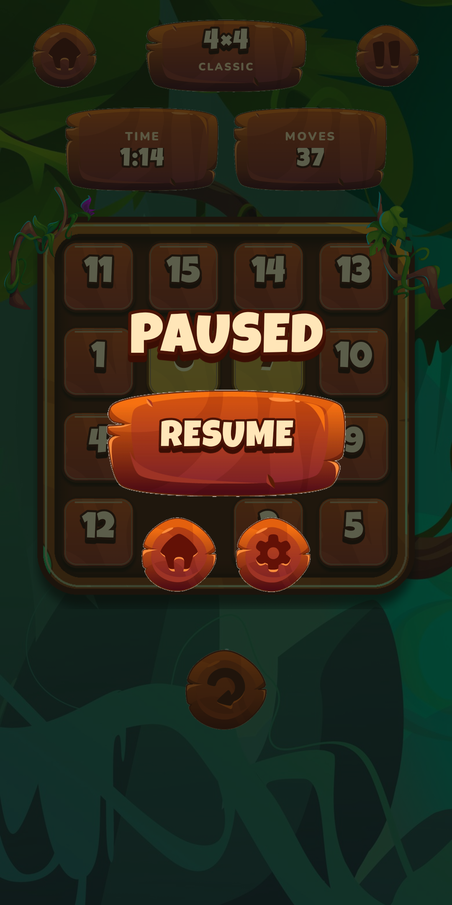<br/><sub>Paused</sub></td>
    <td align="center">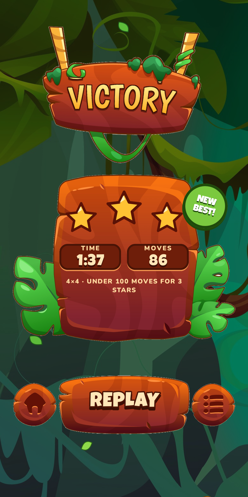<br/><sub>Victory</sub></td>
    <td align="center">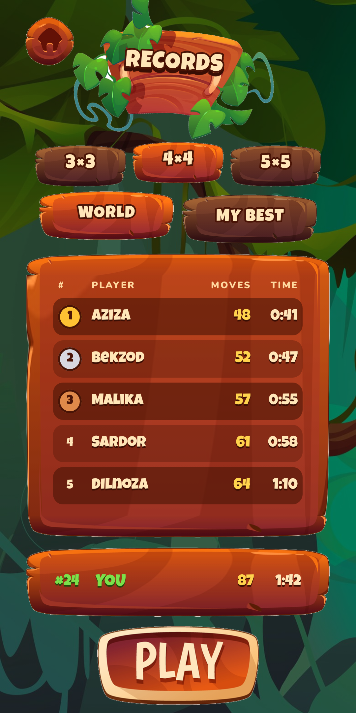<br/><sub>World leaderboard</sub></td>
    <td align="center">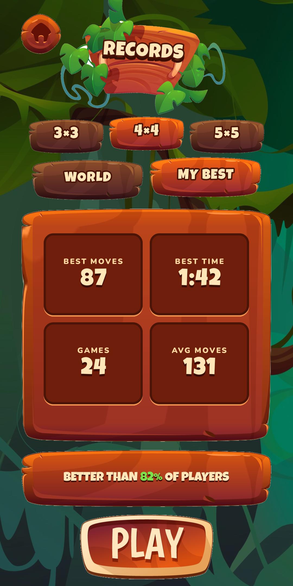<br/><sub>My best</sub></td>
  </tr>
  <tr>
    <td align="center">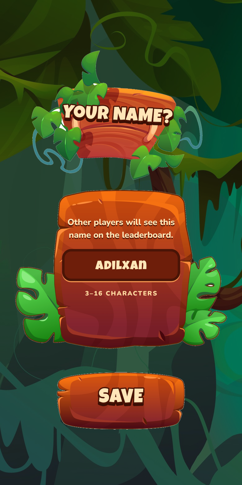<br/><sub>Player name</sub></td>
    <td align="center">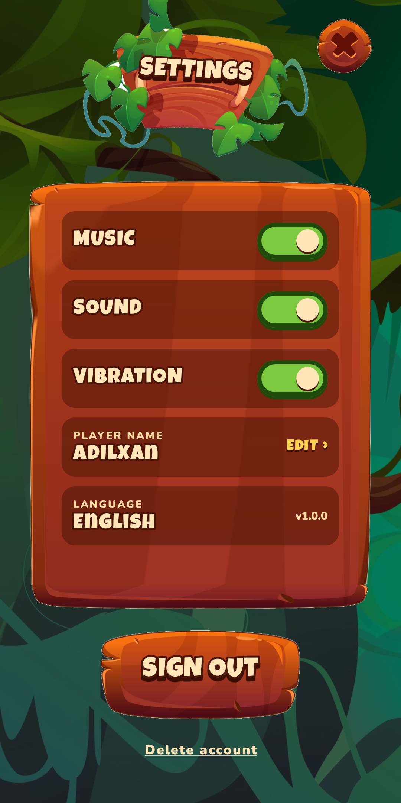<br/><sub>Settings</sub></td>
    <td align="center">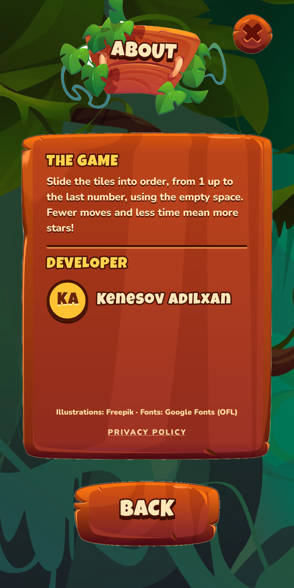<br/><sub>About</sub></td>
    <td></td>
  </tr>
</table>

The screenshots are rendered from the real Compose screens by the Roborazzi tests, so they always match the code (see [Testing and quality](#testing-and-quality)).

## Tech stack

| Area | Libraries |
|---|---|
| Language and UI | Kotlin 2.4, Jetpack Compose (BOM 2026.09), custom wooden design system, `core-splashscreen` |
| Architecture | Clean Architecture, Orbit MVI 12, Hilt (KSP), use cases per screen |
| Navigation | Navigation 3 with type-safe `@Serializable` routes, driven by an `AppNavigator` command channel |
| Persistence | Room 2.8 (results and saved games), SharedPreferences (settings and profile) |
| Backend | Firebase Authentication (Google + anonymous), Cloud Firestore, Firebase Analytics |
| Sign-in | Credential Manager + Sign in with Google (`googleid`) |
| Media | `SoundPool` effects, looping `MediaPlayer` music tied to the process lifecycle, `Vibrator` haptics |
| Testing | JUnit 4, kotlinx-coroutines-test, Robolectric + Roborazzi screenshot tests |
| Tooling | R8, Android Lint, GitHub Actions |

## Architecture

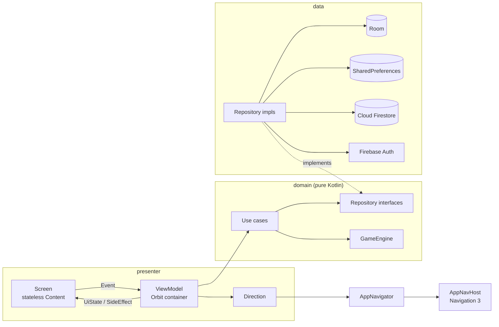

- **`domain`** has no Android or Firebase imports. It holds the board model, the `GameEngine` (shuffle, solvability check and stars), repository interfaces and one use case per screen.
- **`data`** implements those interfaces. A new personal best is written to `leaderboards/{size}/entries/{uid}` in a fire-and-forget call: Firestore queues it offline, and the Firestore security rules reject anything that is not an improvement.
- **`presenter`** follows the same pattern on every screen: `XContract` (events, state, side effects, direction), `XViewModel`, `XDirection` and a stateless `XContent`. Screens with arguments get assisted-inject ViewModels.
- **Layout.** Screens are laid out on the design's 390×844 artboard (`DesignFrame`), which scales to fit any phone.

## Project structure

```
app/src/main/java/uz/visionsystemscorp/puzzle15game/
├── app/            Application (Hilt)
├── di/             Hilt modules: coroutines, database, Firebase, repositories, use cases, directions
├── domain/
│   ├── game/       GameEngine
│   ├── model/      Board, BoardSize, GameResult, Leaderboard, Account, …
│   ├── repository/ Interfaces
│   └── usecase/    splash, login, name, main, game, records, settings
├── data/
│   ├── mapper/
│   ├── repository_impl/
│   └── source/     local (Room, prefs, sound) and remote (Firestore)
├── navigation/     Routes, NavCommand, AppNavigator, AppNavHost
└── presenter/
    ├── screens/    splash, login, name, main, game, win, records, settings, info
    └── ui/         theme, animation, shared wooden components, utils
docs/               GitHub Pages (privacy policy, account deletion), screenshots, Play Store assets
```

## Getting started

Requirements: Android Studio (AGP 9.4), JDK 17+ and an Android 7.0+ device.

```bash
git clone https://github.com/AdilxanKenesov/Puzzle15_Game.git
cd Puzzle15_Game
./gradlew installDebug
```

`app/google-services.json` is committed, so a debug build talks to the project's Firebase. To use your own Firebase project, replace that file and follow [Firebase setup](#firebase-setup).

### Release signing

Release builds are signed with the upload key from `keystore.properties` (not committed) or from environment variables on CI:

```properties
# keystore.properties (project root)
storeFile=../keystore/puzzle15-upload.jks
storePassword=…
keyAlias=puzzle15-upload
keyPassword=…
```

```bash
./gradlew bundleRelease   # app/build/outputs/bundle/release/app-release.aab
```

Without a keystore, `assembleRelease` still builds an unsigned APK, which is useful for checking R8.

## Firebase setup

1. **Authentication → Sign-in method:** enable **Google** and **Anonymous**.
2. **Project settings → Your apps → SHA fingerprints:** add the SHA-1 and SHA-256 of the debug key, the upload key and the **Play App Signing** key (Play Console → Setup → App signing). Then download `google-services.json` again.
3. **Firestore:** create the database (Standard edition), then publish security rules that allow public reads of `leaderboards`, and owner-only writes that may only improve a result.
4. **Firestore → Indexes:** add this composite index:
   - collection `entries`
   - `moves` Ascending, `seconds` Ascending
   - query scope Collection

   The leaderboard ranking needs it.

Data model:

```
users/{uid}                          name, updatedAt          (Google accounts only)
leaderboards/{3|4|5}/entries/{uid}   name, moves, seconds, updatedAt   (best result per size)
```

## Testing and quality

```bash
./gradlew testDebugUnitTest      # unit tests + screenshot tests (render check)
./gradlew recordRoborazziDebug   # re-record docs/screenshots/*.png
./gradlew lintDebug
```

- **Unit tests** cover the game engine (solvability, sliding, stars) and the board model. They also cover the use cases, using in-memory fakes: resume and restart, new-best detection and publishing, sign-in, sign-out, account deletion and onboarding. Mappers are tested too.
- **Screenshot tests** (Robolectric + Roborazzi) render all screens with sample data at 1080×2160, a size the Play Store accepts. The animation clock is driven by hand, so the images are deterministic.

## CI/CD

| Workflow | Trigger | What it does |
|---|---|---|
| [`ci.yml`](.github/workflows/ci.yml) | push to `master`, pull requests | Unit and screenshot tests, Lint, debug APK; uploads reports and the APK |
| [`release.yml`](.github/workflows/release.yml) | tag `v*` or manual | Tests, then a signed AAB and APK with the R8 mapping. Attaches them to a GitHub Release and, if configured, uploads the AAB to the Play **internal** track |

Repository secrets for releases:

| Secret | Value |
|---|---|
| `PUZZLE15_KEYSTORE_BASE64` | `base64 -w0 keystore/puzzle15-upload.jks` |
| `PUZZLE15_KEYSTORE_PASSWORD` | upload keystore password |
| `PUZZLE15_KEY_ALIAS` | `puzzle15-upload` |
| `PUZZLE15_KEY_PASSWORD` | upload key password |
| `PLAY_SERVICE_ACCOUNT_JSON` | *(optional)* Play Console service-account JSON for automatic uploads |

To release, run `git tag v1.0.0 && git push origin v1.0.0`. Google Play requires the very first AAB to be uploaded by hand in the Play Console; after that the workflow can publish on its own.

## Privacy

- [Privacy policy](https://adilxankenesov.github.io/Puzzle15_Game/privacy-policy)
- [Delete your account](https://adilxankenesov.github.io/Puzzle15_Game/account-deletion)

Both are served from [`docs/`](docs) with GitHub Pages. Play Console answers are in [`docs/store/data_safety.md`](docs/store/data_safety.md).

## Credits and license

- **Illustrations and UI art:** [Freepik](https://www.freepik.com), used under the Freepik license, with attribution shown in the app's About screen.
- **Fonts:** [Luckiest Guy](https://fonts.google.com/specimen/Luckiest+Guy) and [Nunito](https://fonts.google.com/specimen/Nunito), under the SIL Open Font License.
- **Sound effects and music:** synthesized for this project.

Code © 2026 VISION SYSTEMS CORP. All rights reserved. The artwork belongs to its authors and may not be reused outside this app.
